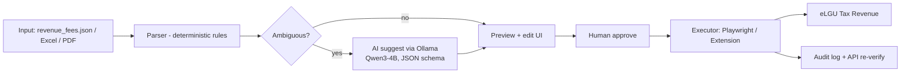

# PLAN — ELGU Fee Setup Assistant

> **For the executing agent:** Read this file top to bottom first, then `HANDOFF.md`. This plan is self-contained. Work phase by phase; do not skip acceptance criteria. Ask the human only for items listed under [§12 Open Decisions](#12-open-decisions-for-the-human). All other choices are already decided in [§3 Defaults](#3-locked-defaults-do-not-relitigate).

---

## 1. Goal

Build a **local, human-in-the-loop assistant** that converts LGU revenue-code fees into eLGU BPLS Tax Revenue configuration, safely and verifiably.

**Core principle (non-negotiable):**

> Deterministic parser + executor does the work. AI only *suggests* mappings for ambiguous fees. A human approves every Submit. AI never clicks or submits autonomously.

Why this shape: most ordinance fees are rule-based (graduated brackets, % rates, flat amounts) and must be exact to the centavo. An LLM doing arithmetic or clicking introduces unacceptable error. The verified samples in this repo prove the deterministic path works.

### Usefulness (beyond one-time setup)

1. Loading a new ordinance revision into eLGU (revisions recur; Maddela 2027/2028 already exist in-system).
2. Onboarding other LGUs on the same eLGU platform with different ordinances.
3. **Audit mode:** compare live eLGU configuration against ordinance text; flag drift/missing fees.
4. **Simulation:** test a parsed bracket schedule against sample gross amounts before encoding it.

---

## 2. Current state (already done — do not redo)

- Playwright scaffold in `src/`; persistent login profile at `.auth/chrome-profile` (**never commit**).
- Full recon of eLGU Tax Revenue: License, Permit, Sanitary, Garbage (Tax Revenues + Calculations + detail rows), Fixed Fees, Other Fees (separate endpoints). See `HANDOFF.md` for the API model.
- **13 SAMPLE fees created and API-verified** in the training app, covering: Gross Range (amount brackets), Gross Range (rate tiers), Gross Rate, Capital Range, Gross Excess, Options, Other Range (sqm), Quantity, Fixed Amount, Fixed Fee page, Other Fee BASIC. Report: `elgu_sample_verification.json`; raw audit: `elgu_sample_audit.json`.
- `revenue_fees.json`: 65 ordinance fees with sanitized eLGU codes (e.g. `MFG-2A.02(a)` → code `MFG-2A02-A`). Regenerate via `src/import-updated-fees.js` from `_incoming_fees.json` (gitignored).
- Repo pushed to `https://github.com/jaymarrecolizado-tech/elgu-prosetup` (`main`).

**Key files today**

| Path | Role |
|------|------|
| `revenue_fees.json` | Input: 65 fees (`code`, `target_page`, `article_section`, `specific_fee_name`, `rate_structure`, `amount_or_formula`) |
| `HANDOFF.md` | Session state, samples, lessons, commands |
| `src/run-configure-fees.js` | Scaffold runner (not yet the full 65-fee runner) |
| `src/form/domInject.js` | Portable DOM helpers (extension reuse) |
| `src/make-sample-fee.js`, `src/make-category-samples.js`, `src/make-fee-type-samples.js` | Sample creation (proven patterns; consolidate, don't copy-paste) |
| `src/fix-*.js`, `src/probe-*.js`, `src/debug-expand.js`, `src/test-option-detail.js` | One-off explorations — reference only; fold lessons into the runner, then delete/archive |
| `src/verify-all-samples.js`, `src/verify-category-samples.js` | API audit pattern to generalize into Audit Mode |
| `src/config.js`, `.env.example` | `ELGU_LOGIN_URL` via env; never hardcode URLs/secrets |
| `src/import-updated-fees.js` | Normalize pasted fee JSON → `revenue_fees.json` |

---

## 3. Locked defaults (do not relitigate)

| Decision | Default |
|----------|---------|
| Form factor order | **Local web app first** (Phase 1–2), **Chrome Extension second** (Phase 3) |
| Execution (Phase 1) | Playwright with `.auth/` persistent profile (existing pattern) |
| Execution (Phase 3) | Extension content script inside the user's already-logged-in eLGU tab |
| AI runtime | **Ollama** on localhost (free, offline, no data leaves the machine) |
| AI model (primary) | **Qwen3-4B-Instruct** GGUF Q4_K_M (~2.5 GB) — fits RTX 4050 6 GB VRAM |
| AI model (optional alternate) | Qwen2.5-7B-Instruct Q4_K_M if 4B underperforms on classification |
| AI role | Suggest mapping + confidence + explanation for ambiguous fees only; structured JSON output validated against schema |
| Fine-tuning | **Later** (Phase 4), QLoRA on Qwen3-4B only after a reviewed dataset exists |
| First input format | `revenue_fees.json` (Excel import Phase 2, PDF/OCR later) |
| Backend language | Keep Node.js (existing codebase); Python only for fine-tuning notebooks/scripts in `training/` |
| Target revision handling | Explicit selector in UI; never assume. Training default observed: revision id `2` |
| Submit policy | Dry-run default; Submit requires explicit per-run human confirmation |
| Git author | JE Lite <jaymar.recolizado@dict.gov.ph>; no AI co-author trailers |

Hardware target: Acer Predator Helios Neo 16, 24 GB RAM, RTX 4050 (~6 GB VRAM). Everything (app + Ollama) must run locally on it.

---

## 4. Target architecture



### Components

1. **Parser (`src/parser/`)** — pure functions, unit-tested. Text → typed config (§5). No browser, no AI.
2. **Classifier rules (`src/parser/classify.js`)** — `rate_structure` + formula shape → calculation type. AI is only a fallback here.
3. **Web app (`src/server/` + `public/`)** — localhost only (`127.0.0.1`). Pages: Load → Preview/Edit → Dry-run → Submit → Audit log. Plain HTML/JS frontend (no framework build step).
4. **Executor (`src/executor/`)** — Playwright driver implementing §7 lessons; one function per page kind (tax revenue, fixed fee, other fee). Idempotent: skip if code already exists.
5. **AI service (`src/ai/`)** — Ollama client (`http://127.0.0.1:11434`), few-shot prompt from verified samples, JSON-schema validation, confidence + rationale. Disabled gracefully if Ollama absent.
6. **Audit (`src/audit/`)** — read live config via the same API-capture pattern as `src/verify-all-samples.js`; diff vs expected config; JSON + UI report.
7. **Extension (`extension/`, Phase 3)** — MV3, side panel UI, content script reusing `src/form/domInject.js` logic; talks to the local web app (native `fetch` to localhost) for parsing/AI. Host permissions restricted to eLGU domains only.

---

## 5. Intermediate schema (`elgu_config.json` — parser output)

One object per fee. This is the contract between parser, UI, AI, and executor.

```json
{
  "code": "MFG-2A02-A",
  "target_page": "license",
  "description": "Graduated Tax on Manufacturers, ...",
  "source": { "article_section": "MFG-2A.02(a)", "rate_structure": "...", "amount_or_formula": "..." },
  "kind": "tax_revenue | fixed_fee | other_fee",
  "calculation": {
    "type": "Gross Range",
    "multiplier_code": null,
    "for_new": true, "for_renewal": true, "for_retirement": true,
    "with_essential_computation": false,
    "include_for_higher_value_comparison": false,
    "details": [
      { "from": 0.01, "to": 9999.99, "amount": 181.50, "rate": 0, "for_excess_computation": false }
    ]
  },
  "confidence": "high | needs_ai | needs_human",
  "notes": []
}
```

Fixed Fee variant: `{ kind: "fixed_fee", amount, multiplier }`. Other Fee variant: `{ kind: "other_fee", fee_type: "BASIC", fee_class: "COMMON_FEE", amount }` (extend when RANGE/QUANTITY/OPTION sub-types are sampled).

### Parsing rules (proven on samples — implement exactly)

- `X to <Y: A PHP` → `from=X, to=Y-0.01, amount=A, rate=0`
- `Less than X: A` → `from=0.01, to=X-0.01`
- Final `Z or more: P% of 1%` → `from=Z, to=99999999999, amount=<prev bracket amount>, rate=P/100/100, for_excess_computation=true`. (`41 1/4% of 1%` → `0.004125`; `55% of 1%` → `0.0055`)
- Pure % (`2% of gross`) → Gross Rate (or Capital Rate if capital-based): `rate=P/100, amount=0`
- Two-tier % (Retailers §2A.02(d)) → Gross Range: tier 1 `rate`, tier 2 `amount=tier1_cap × rate1, rate=rate2, for_excess=true`
- `For every 5,000 in excess of 30,000: 15 PHP` → Gross Excess detail: `in_excess_of=30000, for_every=5000, amount=15` (**no rate field exists**)
- Enumerated label:amount list (banks, amusement, vehicle types) → **Options**; detail `multiplier` must be code-style (`rural_thrift_savings_banks`), `amount` exact
- Floor-area tiers → **Other Range**, calculation multiplier code `sqm`; details `from/to/amount` (no rate field)
- Per-unit flat (per day/head/dog/table) → **Quantity** (`multiplier="quantity"`, `amount`) or Fixed Amount when quantity semantics don't matter — flag choice in `notes`
- Single flat amount → Fixed Amount (tax revenues) / Fixed Fee `amount` / Other Fee BASIC `amount` per `target_page`
- Unparseable or multi-concept (e.g. Market §5I.03, Rentals §5A.01, Building §3O.01 external reference) → `confidence: "needs_human"`, never guess

**Validation (parser must enforce):** brackets contiguous & non-overlapping; amounts/rates ≥ 0; top bracket present for graduated schedules; duplicate `code` detection; every fee yields exactly one config or an explicit `needs_human` entry.

---

## 6. Phases & tasks

### Phase 0 — Consolidate (½ day)

- [ ] Move proven helpers from `make-*.js` / `fix-*.js` into `src/parser/`, `src/executor/`, `src/form/`; keep CLI entrypoints thin.
- [ ] Delete or move one-off probes to `scripts/archive/` (`debug-expand`, `probe-multiplier`, `test-option-detail`, `fix-fee-type-details*`).
- [ ] Add unit tests for the parser (Node's built-in `node:test`; no new framework). Cover §5 rules incl. Retailers, §3A.01(1) excess, top-bracket fractions.
- [ ] `npm test` passes; `graphify update .` run.

**Accept:** repo has no duplicated fill/submit logic; parser tests green.

### Phase 1 — Deterministic runner + local web UI (core MVP)

- [ ] Parser: `revenue_fees.json` → `elgu_config.json` for all 65 fees; report counts by `confidence`.
- [ ] Executor: create fee + calculation + all details per config; idempotent skip-if-exists; per-fee structured log (`logs/run-*.json`, gitignored).
- [ ] Modes: `--dry-run` (fill then Cancel, zero submits) and `--submit` (requires typing/conf UI confirmation).
- [ ] Web UI (localhost): table preview of parsed configs (editable amount/rate/type), dry-run/submit buttons, live log, target **ordinance revision selector** (required, no default assumption for real runs).
- [ ] Audit mode v1: re-read created fees via API capture; diff vs `elgu_config.json`; show PASS/PARTIAL/FAIL (generalize `src/verify-all-samples.js`).

**Accept:** dry-run over all 65 configs completes with a report; submit of a 5-fee subset in training verifies PASS via audit; no fee is submitted without confirmation.

### Phase 2 — AI assist (Ollama)

- [ ] `src/ai/suggest.js`: for `needs_ai` rows only, prompt Qwen3-4B with few-shot examples from `elgu_sample_verification.json`; require JSON matching §5 schema; validate + re-ask once on invalid JSON.
- [ ] UI shows suggestion, confidence, one-line rationale, and diff vs rule-based guess; human accepts/edits/rejects. Accepted suggestions are logged as future training pairs (`training/pairs.jsonl`, gitignored until reviewed).
- [ ] Excel import (`.xlsx` → same fields as `revenue_fees.json`) using a maintained lib; PDF text extraction later only if needed.
- [ ] Graceful offline behavior: if Ollama/model missing, UI still fully works rule-based.

**Accept:** with Ollama running, ambiguous rows get schema-valid suggestions; with Ollama stopped, Phase 1 flow is unaffected.

### Phase 3 — Chrome Extension executor

- [ ] MV3 extension in `extension/`: side panel (Load config → preview → Execute in current tab), content script from `domInject.js` + executor DOM logic, background service worker minimal.
- [ ] Permissions: only eLGU hosts (`https://*.oueg.info/*` plus configurable LGU host in options). No `<all_urls>`.
- [ ] Talks to local web app for parser/AI; all secrets/session stay in the user's real Chrome login — no `.auth/` needed in this mode.
- [ ] Same dry-run (highlight-only / fill-no-submit) and confirm-before-submit policy.

**Accept:** on a logged-in eLGU tab, extension dry-runs and then submits one test fee that audit-verifies; Playwright path still works.

### Phase 4 — Fine-tune (only if Phase 2 data justifies it)

- [ ] Dataset: reviewed pairs from Phase 2 + the 13 verified samples + synthetic bracket variations; split train/held-out by fee (not by row).
- [ ] QLoRA fine-tune Qwen3-4B via Unsloth in `training/` (Python); 6 GB VRAM budget: 4-bit, gradient checkpointing, seq ≤ 2048.
- [ ] Eval gate: held-out exact-match on amounts/rates/brackets must be 100% to promote; otherwise model stays advisory.
- [ ] Publish as local Ollama model (`ollama create elgu-mapper -f Modelfile`); document rollback to base model.

**Accept:** eval report in `training/EVAL.md`; promoted model (if any) selectable in UI; base model remains default until gate passes.

---

## 7. Executor lessons (must implement — learned the hard way)

1. Creating a calculation **auto-creates a placeholder detail** (`0–1000`, `option`, `quantity`). **Edit row 1**, then Add the rest. Never leave the placeholder.
2. Masked amount fields (`₱`) and code fields on **Update** modals only persist with real keyboard typing (`pressSequentially` / `typeInto` pattern). `fill()` and native setters silently revert to `0` there. Add forms tolerate `fill()`; use typing everywhere for consistency.
3. Options / Other Range calculations require a **multiplier code at creation** (`bank_type` → label “Bank Type”, `sqm` → “Sqm Range”, `quantity`). Submit without it fails silently (modal stays / calc missing) — always verify the calculation appears before adding details.
4. Option detail `multiplier` values must be code-style (`pawnshops_money_shops_lending`), not display text.
5. Detail tables include an empty spacer `<tr>` — target `table tbody tr:has(button)`; first button = edit, second = delete (**never click delete in automation**).
6. After each Submit, panels may collapse or a modal may linger — re-expand the fee and dismiss modals before the next Add; verify via toast text (`successfully created/updated`) and, at audit time, via API.
7. React-Select fields have no `name`; use `input[id^="react-select"]` inside the open modal and click the exact option text.
8. Always wait for `networkidle` + a short settle delay after navigation/submits; the SPA re-renders detail sections.
9. Keep the persistent profile: `chromium.launchPersistentContext('.auth/chrome-profile', ...)`. Never commit `.auth/`.

---

## 8. Security & safety rules

- **Never commit:** `.env`, `.auth/`, `session-*.json`, `browser-status.json`, `node_modules/`, `graphify-out/`, `.cursor/`, `_incoming_fees.json`, run logs with page dumps. (Already in `.gitignore` — keep it that way; check `git status` before every commit.)
- No credentials in code or prompts. eLGU login is always manual (Playwright profile or user's Chrome).
- AI runs **locally only** (Ollama). Do not send ordinance text, configs, or page content to any cloud LLM API.
- Web app binds `127.0.0.1` only; extension host permissions scoped to eLGU domains.
- Every submit run writes an audit log (who/when/what codes) locally; audit-verify after submit.
- Git commits: author JE Lite <jaymar.recolizado@dict.gov.ph>, **no** Co-authored-by/AI trailers; stage only intended source files.

---

## 9. Testing

- **Unit:** parser rules (§5), code sanitization, schema validation, bracket contiguity. Fixtures from `revenue_fees.json` + verified samples.
- **Integration (training app only):** dry-run all; submit small subsets; audit PASS required before scaling a batch.
- **Regression:** after any executor change, re-run one sample per calculation type (the §2 list) in training.
- Never test submits against a production LGU instance without explicit human instruction for that run.

---

## 10. Definition of done (whole project)

1. All 65 fees parse to `elgu_config.json` (or explicit `needs_human` with reason).
2. Dry-run report + human-approved submit in training; audit shows PASS for submitted fees (PARTIAL only where §5 says so, with notes).
3. Web UI usable end-to-end by a non-developer following `README` steps.
4. Extension executes in a real logged-in tab with the same guarantees.
5. AI suggestions (and fine-tuned model, if promoted) remain advisory; removing AI breaks nothing.

---

## 11. Instructions for the executing agent

1. Run `graphify query "fee parser executor tax revenue"` before exploring code (project rule); `graphify update .` after code changes.
2. Prefer the existing patterns in `src/make-sample-fee.js` (create/fill/check flow) and `src/verify-all-samples.js` (API audit) over inventing new ones.
3. Keep files < ~300 lines; split parser/executor/UI/AI into modules. No duplicated fill/submit helpers.
4. Commit per phase with clear messages; review `git status` and unstage anything local-only before committing. Push only when the human asks.
5. If a fee's mapping is genuinely ambiguous, mark `needs_human` and move on — do not improvise amounts.
6. Update `HANDOFF.md` at the end of each phase (what changed, how to run, what's next).

---

## 12. Open decisions for the human

1. Top-bracket semantics: base amount + excess rate (current SAMPLE behavior) vs pure % of gross?
2. `with_essential_computation` for essential-commodities fees (§2A.02(c) half-rate rule)?
3. Production target ordinance revision id (training default is `2`; do not load real codes until confirmed)?
4. Delete training `SAMPLE-*` records before real loads, or leave as reference?
5. First *real* input beyond JSON: Excel or ordinance PDF?

*Defaults in §3 apply until the human answers; Phase 0–1 can proceed without blocking on these, except real (non-training) submits.*
